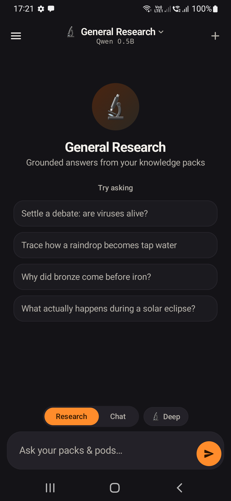
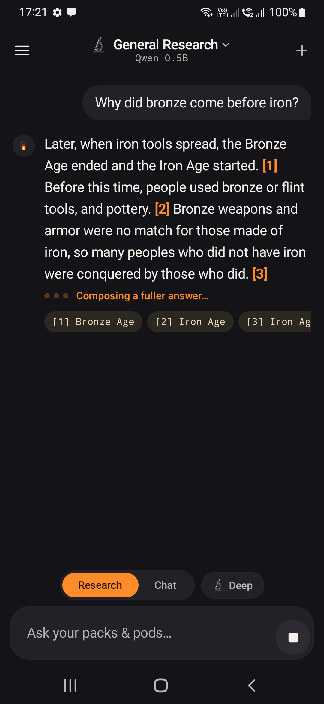
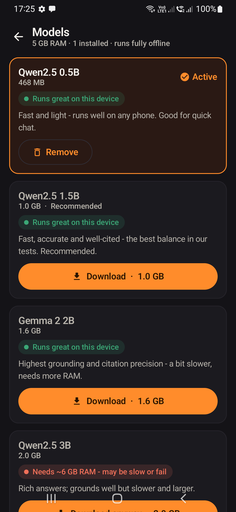
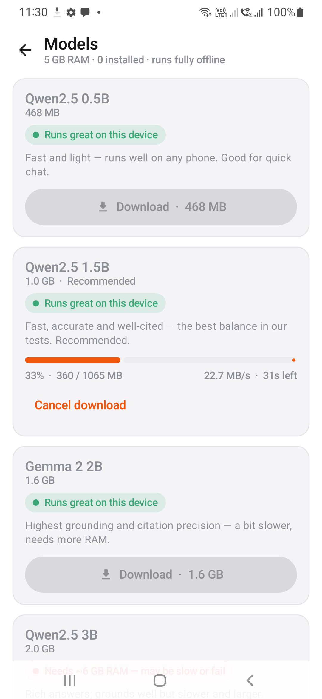

# Fireplace - demo

**Full screen recording:** [`fireplace-demo.mp4`](fireplace-demo.mp4) (60 s, on a Samsung Galaxy M31 - a budget 5 GB phone, the *worst case* for speed; a 12 GB flagship is several times faster).

The walkthrough: ask a research question → an instant grounded, cited answer → the sources with the exact text → the on-device model catalogue → Deep Research.

---

### 1. Zero-config start
Open the app; it auto-downloads the right model for the phone and bundles five knowledge packs. General Research is live, fully offline (`Qwen 0.5B` shown as the active model).

### 2. Grounded, cited answer
Ask *"Why did bronze come before iron?"* - a cited answer streams in, every claim tagged `[n]`, with the source chips it drew from.

### 3. The sources, with the exact text
Under every answer: a **"Well grounded · % verified"** badge, the **Sources** with the *exact passage* each claim came from, and **Continue exploring** follow-ups that keep you learning - each answerable from your packs.

### 4. On-device model catalogue
Pick, download (with resume + ETA), switch, or remove models - each tagged with how well it fits *your* phone's RAM (green *"Runs great on this device"*, red *"Needs ~6 GB RAM"*).

### 5. Deep Research
A toggle that plans the question into sections, researches each from your sources, and assembles one in-depth, cited answer.

---

> Everything above runs with the phone in airplane mode. The network is touched only once - to download the model on first run.
